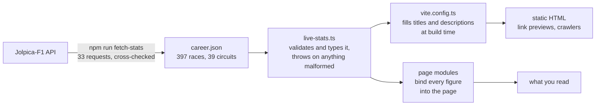

<div align="center">

<a href="https://l-hamilton.vercel.app">
  
</a>

<h1>Lewis Hamilton — a fan-built driver site</h1>

<p>
  <b>Four pages. Twenty seasons. Seven world titles. Every figure wired to live race data.</b><br>
  A scroll-driven Formula 1 site in TypeScript, Three.js and GSAP, with no framework underneath.
</p>

<a href="https://l-hamilton.vercel.app">
  
</a>

<p>
  
  
  
  
  
  
  
  
</p>

</div>

> [!IMPORTANT]
> **This is an unofficial fan project.** It is not affiliated with Lewis Hamilton, Scuderia Ferrari
> or Formula 1, and it is not his official site (that is [lewishamilton.com](https://www.lewishamilton.com/)).

## What it is

A remake of [landonorris.com](https://landonorris.com) with a different driver in it.

The structure, the sections and the scroll mechanics follow that site. The driver, the palette
(Ferrari red in place of McLaren lime) and all of the career data are Hamilton's. Each effect was
studied on the original as it runs, measured, and rebuilt in a new codebase: a WebGL hero, pinned
and scrubbed scroll sections, a 3D circuit map, and a data layer that refuses to build if a number
is missing.

<div align="center">
  
</div>

## The four pages

### Home — [`/`](https://l-hamilton.vercel.app/)


The opening is one pinned sequence. The portrait closes into a plate while two bands of text run
past it, a signature is drawn over it stroke by stroke, and the statement reveals behind an accent
bar. Below it: a photo collage, the On Track and Off Track doors, the helmet wall, the store,
partners, socials and the footer.

<table>
  <tr>
    <td width="50%"></td>
    <td width="50%"></td>
  </tr>
  <tr>
    <td align="center"><sub><b>On Track / Off Track.</b> Pinned while the cut-outs close in from the edges.</sub></td>
    <td align="center"><sub><b>Helmets Hall of Fame.</b> 26 helmets from his McLaren, Mercedes and Ferrari years.</sub></td>
  </tr>
  <tr>
    <td></td>
    <td></td>
  </tr>
</table>

### On Track — [`/on-track`](https://l-hamilton.vercel.app/on-track)

<table>
  <tr>
    <td width="50%"></td>
    <td width="50%"></td>
  </tr>
  <tr>
    <td align="center"><sub><b>The helmet flight.</b> One glTF model, flown through the top of the page by the scroll.</sub></td>
    <td align="center"><sub><b>Career figures and seasons.</b> Counted up from the data layer, never typed in.</sub></td>
  </tr>
</table>

The racing record: starts, wins, podiums, poles and fastest laps, a table of all twenty seasons
with the championship years marked, the wins as a results feed, his junior career from 1995 to
2006, and the season's remaining rounds with a countdown to the next one.

<table>
  <tr>
    <td width="33%"></td>
    <td width="33%"></td>
    <td width="33%"></td>
  </tr>
</table>

### Off Track — [`/off-track`](https://l-hamilton.vercel.app/off-track)

<table>
  <tr>
    <td width="50%"></td>
    <td width="50%"></td>
  </tr>
  <tr>
    <td align="center"><sub><b>Beyond the circuit.</b> The opening pair of screens.</sub></td>
    <td align="center"><sub><b>Personal projects.</b> A drifting gallery with its captions in step.</sub></td>
  </tr>
</table>

Four projects in the reference's layout: Mission 44, fashion and the Met Gala, *F1: The Movie*,
and Almave. Every fact on the page is third-person site copy with at least one source recorded
beside it in [`src/content/off-track.ts`](src/content/off-track.ts). Nothing on the site is a
quote attributed to him.

### Calendar — [`/calendar`](https://l-hamilton.vercel.app/calendar)


The season's 23 rounds, with the circuit of the selected round drawn in 3D: a lit ribbon under a
slowly orbiting camera, its corners numbered, with bloom over the render. Stepping to another
round wipes the ribbon away and draws the next one over two seconds. You can drag it to spin it.

<table>
  <tr>
    <td width="33%"></td>
    <td width="33%"></td>
    <td width="33%"></td>
  </tr>
  <tr>
    <td align="center"><sub>The season so far</sub></td>
    <td align="center"><sub>Every Grand Prix since 2007</sub></td>
    <td align="center"><sub>Countdown to race day</sub></td>
  </tr>
</table>

### Moving between them


The menu button morphs between its bars and a cross and fills like liquid on hover. A page change
plays one panel out and in: the same panel that serves as the loader on a first visit.

## The numbers

<div align="center">

| Starts | Wins | Podiums | Poles | Fastest laps | Points | World titles |
| :----: | :--: | :-----: | :---: | :----------: | :----: | :----------: |
| **397** | **106** | **208** | **104** | **69** | **5,247.5** | **7** |

<sub>Lewis Hamilton's Formula 1 record through the 2026 Singapore Grand Prix (11 October 2026).
Twenty seasons, 2007 to 2026, with McLaren, Mercedes and Ferrari. Titles in 2008, 2014, 2015 and 2017 to 2020.<br>
Source: <a href="https://github.com/jolpica/jolpica-f1">Jolpica-F1</a>, fetched 13 October 2026.</sub>

</div>

That table is a snapshot, and it is the only place these figures are typed. He is still racing,
so the totals move every race weekend. The site never hardcodes them:



- **One source.** `tools/fetch-stats.mjs` rebuilds `src/content/generated/career.json` from the
  API and cross-checks wins, poles and fastest laps against separate endpoints before writing.
- **Fail fast.** `live-stats.ts` is the only module that reads that file. The data layer loads
  when `vite.config.ts` does, so a missing or malformed record stops the build and the dev server
  instead of rendering a zero.
- **No stale heads.** Page titles and descriptions state the season, team and title count, so
  they are filled from the same data at build time rather than typed.

## How it is built

| | |
| :-- | :-- |
| **Pages** | Four HTML entry points, with shared sections as partials stitched in by a small Vite plugin. No UI framework. |
| **Language** | TypeScript 5.6 with `strict` and `noUncheckedIndexedAccess`. About 17,000 lines of TypeScript and 14,500 of CSS. |
| **WebGL** | Three.js r174. The scenes are this site's own modules, listed below. |
| **Motion** | One orchestrator: GSAP with ScrollTrigger, over Lenis smooth scrolling. |
| **Vector animation** | Rive, for the circuit outlines. |
| **Type** | Mona Sans and Playfair Display, self-hosted. |
| **Data** | Jolpica-F1, the open successor to the Ergast API. |
| **Hosting** | Static build on Vercel. |

### The WebGL

| Module | What it draws |
| :-- | :-- |
| [`src/HeadScene.ts`](src/HeadScene.ts) | The hero: a contour-line field, the portrait over it, the helmet fitted over the head, and the pointer fluid that plays between them. |
| [`src/FluidCursor.ts`](src/FluidCursor.ts) | The pointer fluid, a stable-fluids solver: velocity and pressure passes at a tenth of the screen's resolution. |
| [`src/ContourField.ts`](src/ContourField.ts) | The background contours: a simplex-noise field reduced to a binary map, then traced into lines in a second pass. |
| [`src/HelmetModel.ts`](src/HelmetModel.ts) | The helmet, a Draco-compressed glTF shared by every scene that draws it. |
| [`src/HelmetScroll.ts`](src/HelmetScroll.ts) | The helmet's flight through the top of On Track, driven by the scroll. |
| [`src/lib/track3d.ts`](src/lib/track3d.ts) | The 3D circuit map: ribbons built from circuit paths, bloom, HTML corner markers projected over the render. |
| [`src/lib/gl-layers.ts`](src/lib/gl-layers.ts) | One WebGL context shown on two canvases, so DOM text can sit between two GL layers. |

### What ships

Sizes from the production build, gzipped:

| Chunk | Size | Loaded |
| :-- | --: | :-- |
| Shared code and GSAP | 90.8 kB | Every page |
| Three.js | 133.8 kB | Home and On Track up front, Calendar when its circuit mounts |
| Home | 18.7 kB | `/` |
| On Track | 13.2 kB | `/on-track` |
| Off Track | 11.9 kB | `/off-track` |
| Calendar | 8.2 kB | `/calendar` |
| 3D circuit map | 29.1 kB | On Track, and Calendar on demand |
| Rive runtime | 30.2 kB, plus 541 kB of WebAssembly | On demand, when a circuit outline mounts |

## Built to hold up

- **Lighthouse 100 for accessibility, best practices and SEO** on all four pages (desktop,
  production build, measured 13 October 2026).
- **360px to 2560px** with no sideways overflow, checked at seven widths on every page.
- **Reduced motion is a real path.** `prefers-reduced-motion` is read once, in
  [`src/lib/motion.ts`](src/lib/motion.ts), so a page can never honour it in one place and ignore
  it in another. Every pinned sequence still delivers its content without the motion.
- **Keyboard and screen readers.** A skip link, a menu that opens and closes from the keyboard,
  and a plain-text copy beside every heading that is split into animated characters.
- **Readable with animation off.** The layout does not depend on an animation having run.

## Run it

Node 20 or newer.

```bash
git clone https://github.com/dhruvin-sarkar/L-Hamilton.git
cd L-Hamilton
npm install

npm run dev          # dev server on http://localhost:5173
npm run build        # production build into dist/
npm run preview      # serves dist/ on http://localhost:4173
npm run typecheck    # tsc --noEmit
npm run fetch-stats  # refetch the career record from Jolpica-F1
```

Set `SITE_ORIGIN` when building for a public address, so link previews get an absolute image URL:

```bash
SITE_ORIGIN=https://example.com npm run build
```

On Vercel that is already done: [`vercel.json`](vercel.json) takes the origin from the project's
production domain and serves the pages on clean addresses (`/on-track`, not `/on-track.html`).

## Where things are

```text
index.html  on-track.html  off-track.html  calendar.html    the four entry points
partials/            shared markup: nav, menu, footer, sections used on more than one page
src/
  main.ts  on-track.ts  off-track.ts  calendar.ts           one module per page
  HeadScene.ts  FluidCursor.ts  HelmetModel.ts  ...          the WebGL scenes
  lib/               motion, reveals, countdown, gallery, 3D circuit map, page transition
  content/           the data layer; generated/career.json is written by fetch-stats
  styles/            design tokens, then one stylesheet per page
public/assets/       images, fonts, the helmet model, flags
tools/               fetch-stats and the asset generators
media/               the pictures in this README
vite.config.ts       build, HTML partials, head tags, data validation
```

## Credits

- **[landonorris.com](https://landonorris.com)** is the site this remakes: its structure, its
  sections and its scroll mechanics. Its circuit-outline Rive file is used as is.
- **[Jolpica-F1](https://github.com/jolpica/jolpica-f1)** for the race data.
- **[mnmxmx/fluid-three](https://github.com/mnmxmx/fluid-three)** (MIT): the pointer fluid is a
  port of its stable-fluids solver.
- **[webgl-noise](https://github.com/stegu/webgl-noise)** by Ian McEwan and Stefan Gustavson
  (MIT): the simplex noise in the contour field.
- **[bacinger/f1-circuits](https://github.com/bacinger/f1-circuits)** (MIT): two of the circuit
  outlines.
- **Mona Sans** and **Playfair Display**, each under the SIL Open Font License.

The full notices are in
[`public/assets/THIRD-PARTY-NOTICES.txt`](public/assets/THIRD-PARTY-NOTICES.txt).

Names, logos, trademarks and photographs belong to their owners. This project claims no rights to
them and is not endorsed by anyone it depicts or names.
