

<a href="https://l-hamilton.vercel.app">
  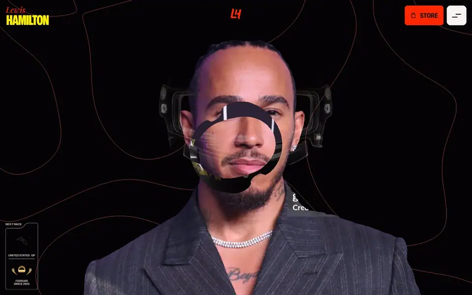
</a>

<h1>Lewis Hamilton</h1>

## 

A remake of [landonorris.com](https://landonorris.com) 

The structure, the sections and the scroll mechanics follow that site. The driver, the palette
(Ferrari red in place of McLaren lime) and all of the career data are Hamilton's. Each effect was
studied on the original as it runs, measured, and rebuilt in a new codebase: a WebGL hero, pinned
and scrubbed scroll sections, a 3D circuit map

  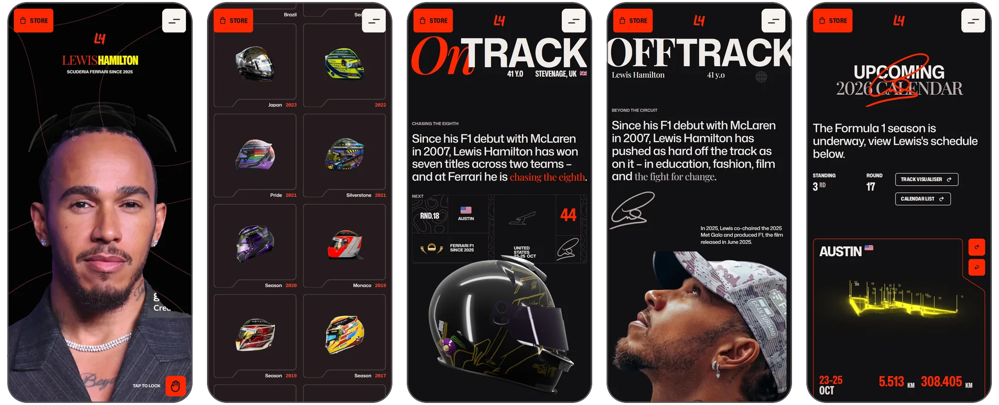

## The pages

### Home 

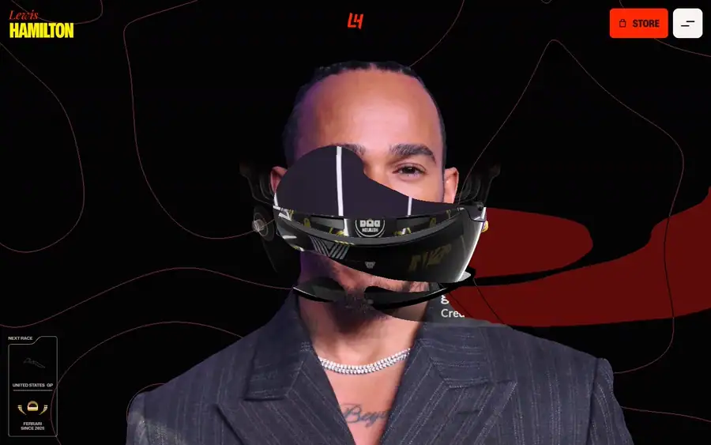

The opening is one pinned sequence. The portrait closes into a plate while two bands of text run
past it, a signature is drawn over it stroke by stroke, and the statement reveals behind an accent
bar. Below it: a photo collage, the On Track and Off Track doors, the helmet wall, the store,
partners, socials and the footer.

<table>
  <tr>
    <td width="50%">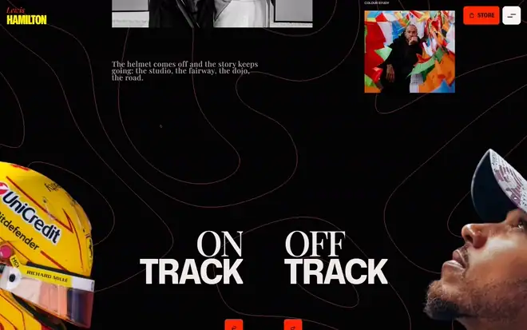</td>
    <td width="50%">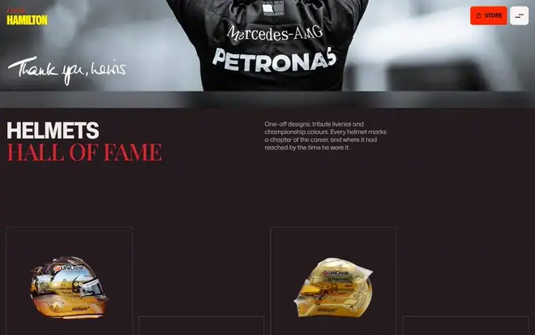</td>
  </tr>
  <tr>
    <td align="center"><b>On Track / Off Track.</b> Pinned while the cut-outs close in from the edges.</td>
    <td align="center"><b>Helmets Hall of Fame.</b> 26 helmets from his McLaren, Mercedes and Ferrari years.</td>
  </tr>
  <tr>
    <td>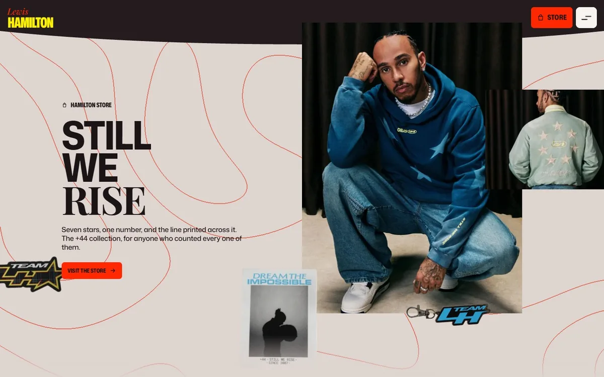</td>
    <td>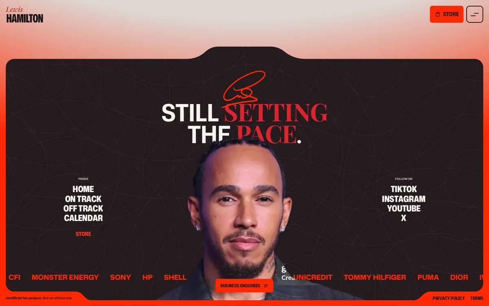</td>
  </tr>
</table>

### On Track 

<table>
  <tr>
    <td width="50%">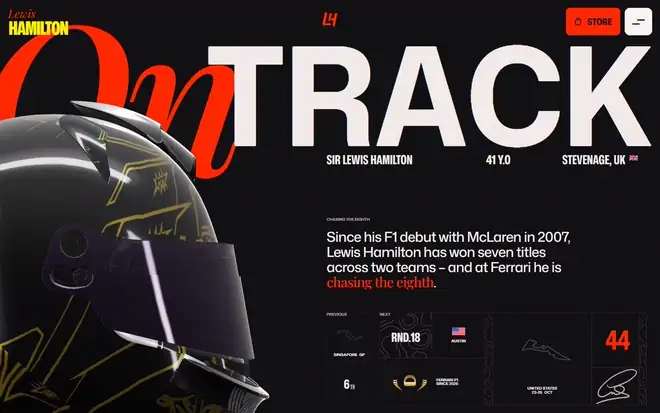</td>
    <td width="50%">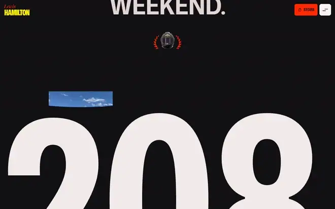</td>
  </tr>
  <tr>
    <td align="center"><b>The helmet flight.</b> One glTF model, flown through the top of the page by the scroll.</td>
    <td align="center"><b>Career figures and seasons.</b> Counted up from the data layer, never typed in.</td>
  </tr>
</table>

The racing record: starts, wins, podiums, poles and fastest laps, a table of all twenty seasons
with the championship years marked, the wins as a results feed, his junior career from 1995 to
2006, and the season's remaining rounds with a countdown to the next one.

<table>
  <tr>
    <td width="33%">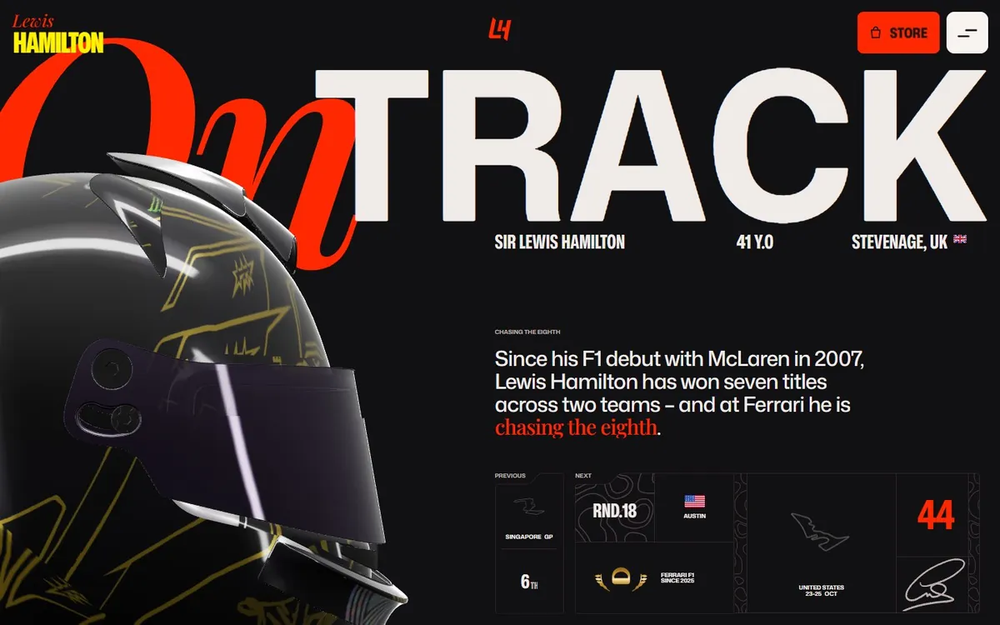</td>
    <td width="33%">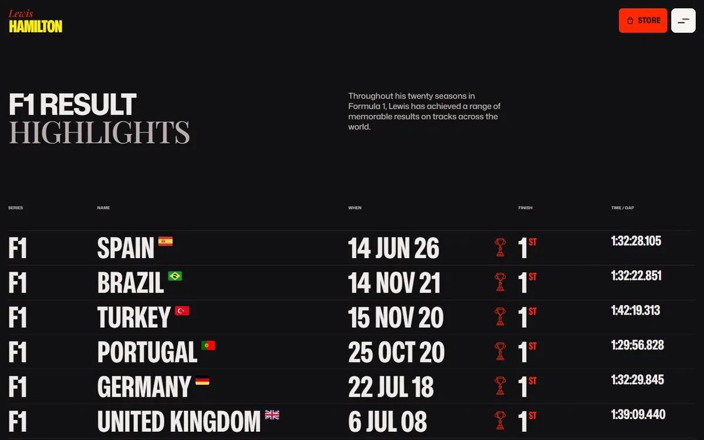</td>
    <td width="33%">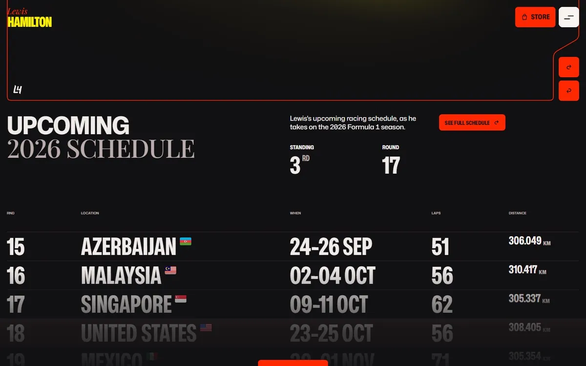</td>
  </tr>
</table>

### Off Track 

<table>
  <tr>
    <td width="50%">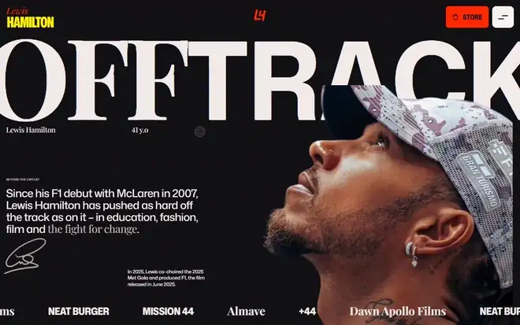</td>
    <td width="50%">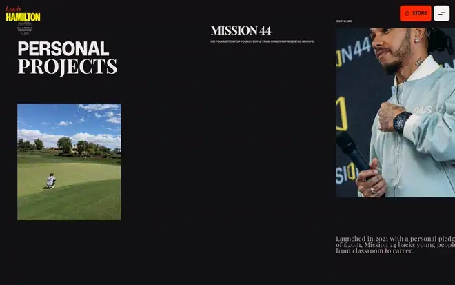</td>
  </tr>
  <tr>
    <td align="center"><b>Beyond the circuit.</b> The opening pair of screens.</td>
    <td align="center"><b>Personal projects.</b> A drifting gallery with its captions in step.</td>
  </tr>
</table>

Four projects in the reference's layout: Mission 44, fashion and the Met Gala, *F1: The Movie*,
and Almave. Every fact on the page is third-person site copy with at least one source recorded
beside it in [`src/content/off-track.ts`](src/content/off-track.ts). Nothing on the site is a
quote attributed to him.

### Calendar 

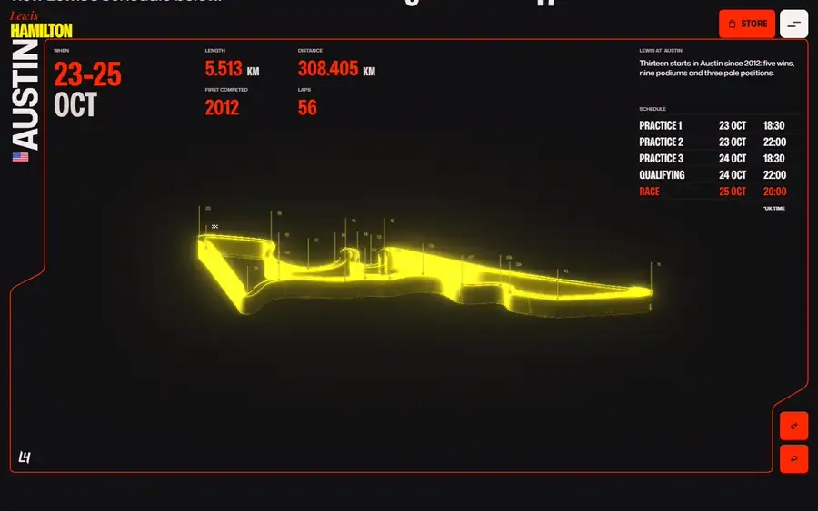

The season's 23 rounds, with the circuit of the selected round drawn in 3D: a lit ribbon under a
slowly orbiting camera, its corners numbered, with bloom over the render. Stepping to another
round wipes the ribbon away and draws the next one over two seconds. You can drag it to spin it.

<table>
  <tr>
    <td width="33%">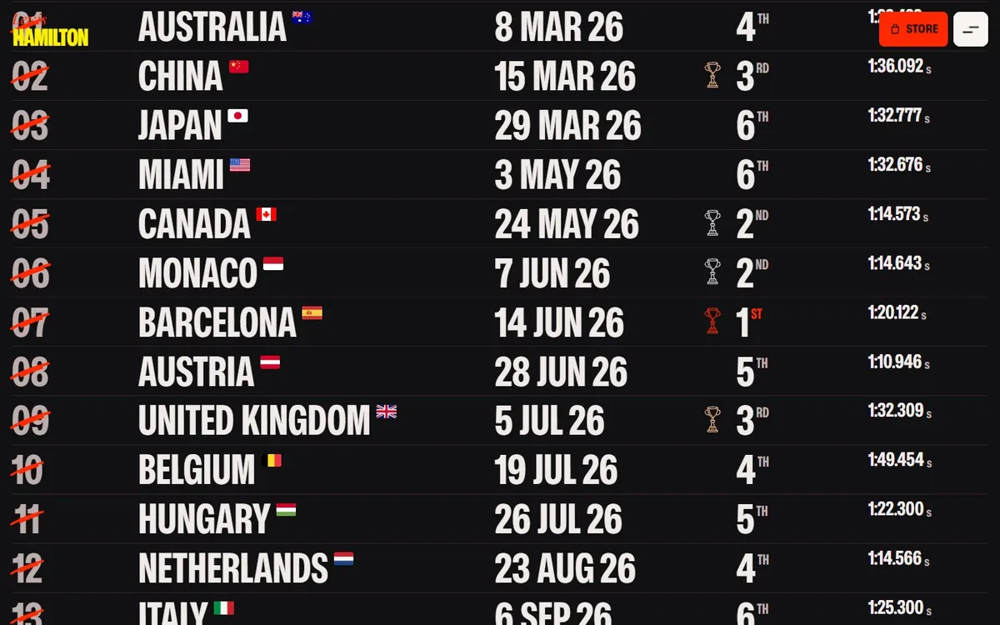</td>
    <td width="33%">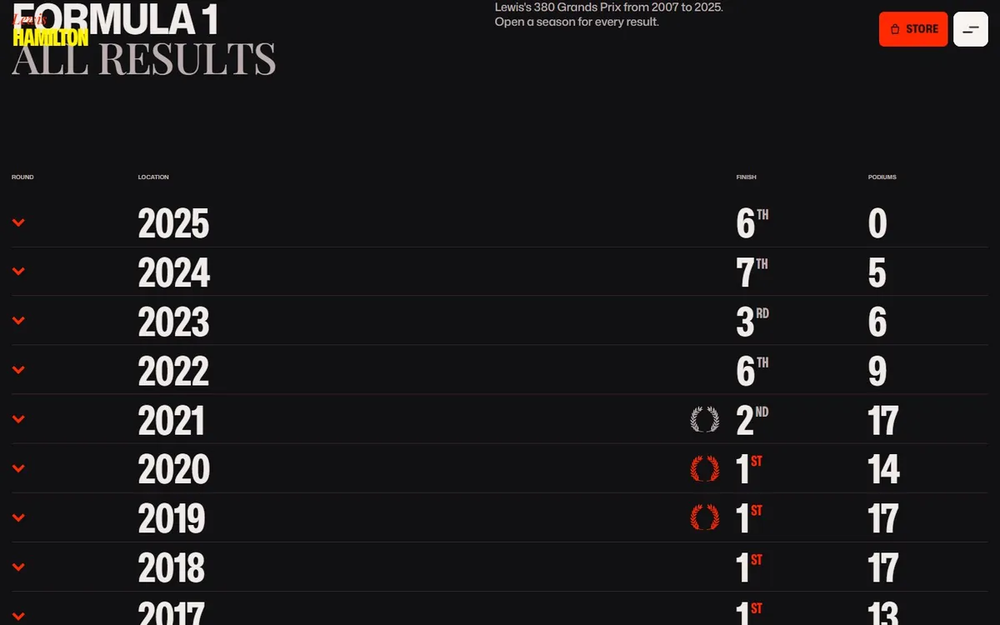</td>
    <td width="33%">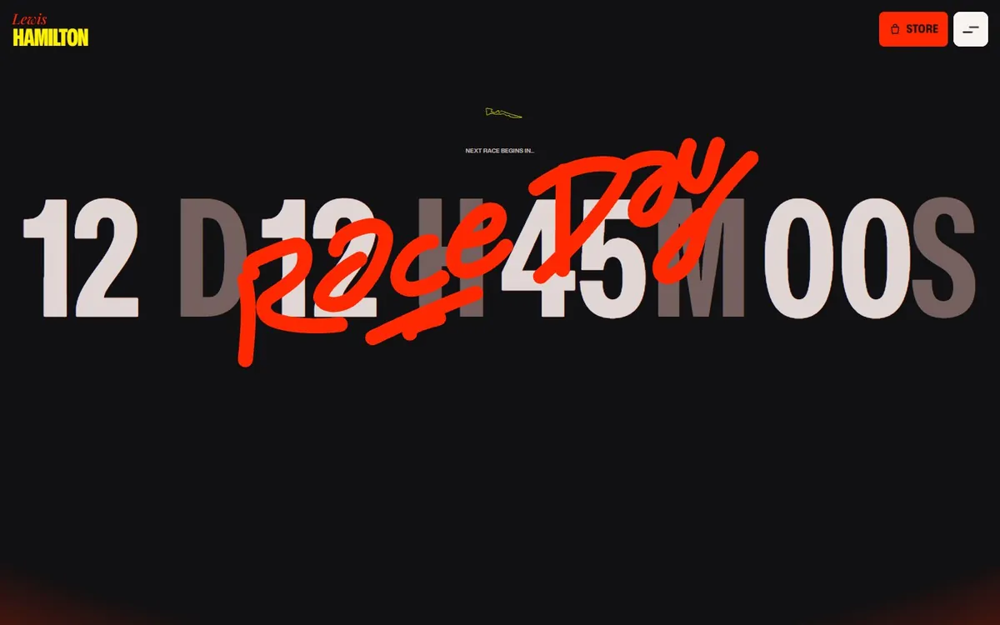</td>
  </tr>
  <tr>
    <td align="center">The season so far</td>
    <td align="center">Every Grand Prix since 2007</td>
    <td align="center">Countdown to race day</td>
  </tr>
</table>

### Transitions

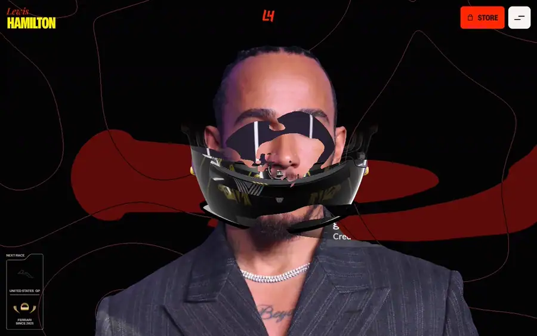

The menu button morphs between its bars and a cross and fills like liquid on hover. A page change
plays one panel out and in: the same panel that serves as the loader on a first visit.

## The stats

| Starts | Wins | Podiums | Poles | Fastest laps | Points | World titles |
| :----: | :--: | :-----: | :---: | :----------: | :----: | :----------: |
| **397** | **106** | **208** | **104** | **69** | **5,247.5** | **7** |

Lewis Hamilton's Formula 1 record through the 2026 Singapore Grand Prix (11 October 2026).
Twenty seasons, 2007 to 2026, with McLaren, Mercedes and Ferrari. Titles in 2008, 2014, 2015 and 2017 to 2020. 
Source: <a href="https://github.com/jolpica/jolpica-f1">Jolpica-F1</a>, fetched 13 October 2026.

That table is a snapshot, and it is the only place these figures are typed. He is still racing,
so the totals move every race weekend. The site never hardcodes them:

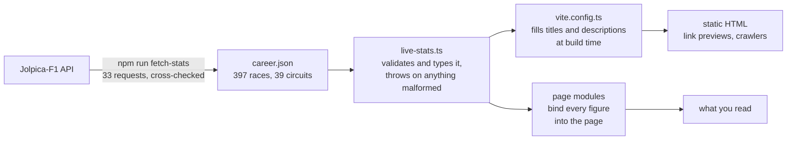

## Credits

- **[landonorris.com](https://landonorris.com)** is the site this remakes: its structure, its
  sections and its scroll mechanics. Its circuit-outline Rive file is used as is.
- **[Jolpica-F1](https://github.com/jolpica/jolpica-f1)** for the race data.
- **[mnmxmx/fluid-three](https://github.com/mnmxmx/fluid-three)** (MIT): the pointer fluid is a
  port of its stable-fluids solver.
- **[webgl-noise](https://github.com/stegu/webgl-noise)** by Ian McEwan and Stefan Gustavson
  (MIT): the simplex noise in the contour field.
- **[bacinger/f1-circuits](https://github.com/bacinger/f1-circuits)** (MIT): two of the circuit
  outlines.
- **Mona Sans** and **Playfair Display**, each under the SIL Open Font License.

The full notices are in
[`public/assets/THIRD-PARTY-NOTICES.txt`](public/assets/THIRD-PARTY-NOTICES.txt).

Names, logos, trademarks and photographs belong to their owners. This project claims no rights to
them and is not endorsed by anyone it depicts or names.
